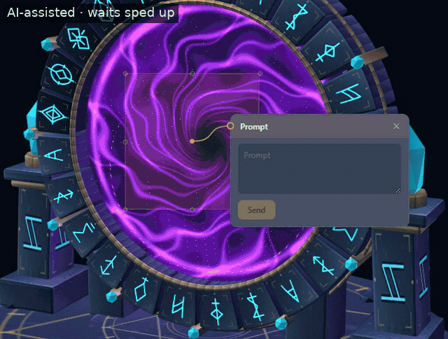
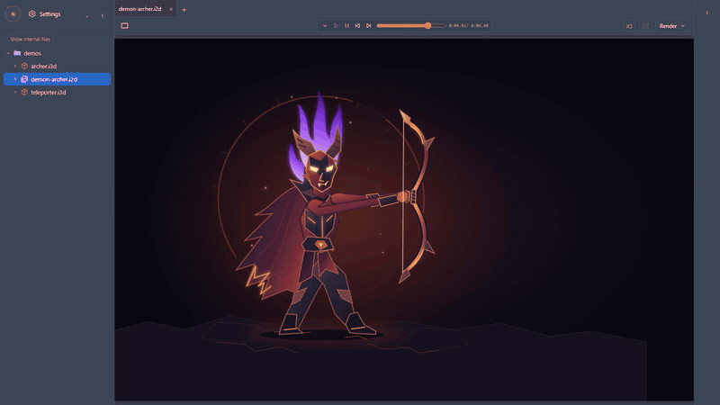

# Alembic

Visual interface and highlight prompts for connecting to AI agents. Connect through an embedded terminal window (tested on Linux) or directly from an existing session. Prompts and highlights go straight to the agent, or are polled through the external client. The canvas supports 2D, 3D, audio and web iframe nodes.

Right now the 3D view is Babylon.js, 2D is SVG/PNG plus an HTML viewer for replay, and iframe nodes embed web pages directly.





## Run

Needs Linux or WSL, Python 3, Node, and an agent CLI such as Codex or Claude Code.

```bash
npm install
npm start -- path/to/project
```

`npm start -- --no-open PATH` runs without opening a browser. Starting and stopping cleans up everything it started. Project state is created in `.alembic/` on first use.
Electron is optional; see [desktop](desktop/). Run CPU checks with `npm test`.

The embedded terminal runs agents with your own permissions, with no sandbox.

## Connect an existing session

```bash
backend/al attach --new -- codex    # run it in a terminal the app can send prompts to
backend/al wait --name my-agent     # or listen from any session and read prompts as they arrive
```

## Nodes

A node is a folder named `name.i3d`, `name.i2d`, `name.audio` or `name.iframe`. See [the contract](docs/frontend-contract.md), [the skills](skills/) and [the demos](tests/mock/demos/).

To add a render backend: add a folder in `render/`, one row in `render/registry.js`, and a fixture for the port's conformance suite. The frontend doesn't change.

## License

MIT
